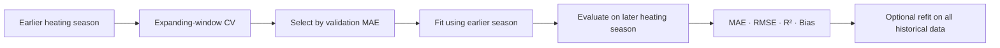

# 🔬 Methodology — Building Energy AI Analytics

> **Scope:** Technical description of a private industrial research workflow. This document contains **no customer data, real building identifiers, fitted models, measured results, or private implementation code**.

[← Back to project overview](README.md)

---

## 🧭 Research Questions

The project investigates how weather and calendar features relate to **daily building natural-gas consumption (Smc/day)**, and how machine learning can help with prediction, interpretation, and operational review.

The main methodological questions are:

1. Do multidimensional weather variables add useful information beyond a temperature-only energy signature?
2. Can a model selected on one heating season generalize to a later season?
3. Which historical weather features are also suitable for **future-facing** forecasts?
4. How can we interpret predictions and flag unusual discrepancies without claiming causal effects or diagnosing equipment faults?

## 🧹 1. Data Preparation

```text
Daily weather + gas records
            ↓
Date parsing & chronological sorting
            ↓
Missing/invalid value checks
            ↓
Weather feature engineering
            ↓
Training and evaluation datasets
```

- Validate date parsing and chronological order.
- Distinguish missing **consumption targets** from missing **weather inputs**.
- Calculate rolling temperature features from available chronological weather observations, including earlier unlabeled days when appropriate.
- Prevent future observations or test-period statistics from leaking into model fitting.
- Fit imputers, encoders, and scalers on **training folds only**.

## 🌡️ 2. Feature Engineering

| Feature family | Examples | Motivation |
| :--- | :--- | :--- |
| Temperature | Mean, minimum, maximum | Direct thermal conditions |
| Degree days | HDD, CDD | Nonlinear heating/cooling indicators |
| Recent weather | Rolling temperature averages | Short-term weather persistence |
| Atmospheric variables | Humidity, dew point, wind, pressure, rain | Additional environmental context |
| Calendar | Day of week, weekend, month | Recurring temporal patterns |
| Interactions | Temperature × weather variables | Combined covariate effects |

For a reference temperature of 18 °C:

$$
\mathrm{HDD}=\max(0,18-T_{\mathrm{mean}}),\qquad
\mathrm{CDD}=\max(0,T_{\mathrm{mean}}-18)
$$

**Forecasting constraint:** A feature is useful in a future-facing model only when it can also be supplied with sufficiently consistent meaning at inference time. This motivates a dedicated **forecast-compatible feature subset**.

## 🤖 3. Baselines and Model Candidates

| Group | Approaches |
| :--- | :--- |
| **Reference models** | Mean prediction; temperature-only energy signature |
| **Linear models** | Linear Regression, Ridge, Lasso |
| **Tree ensembles** | Random Forest, XGBoost, CatBoost |

Feature subsets and candidate models are compared using a **defined, time-aware selection procedure**. This is not described as an exhaustive hyperparameter optimization study.

## 🕒 4. Time-Aware Model Evaluation



The sequence matters:

1. **Model selection:** Compare candidate model/feature combinations with expanding-window `TimeSeriesSplit` on the earlier season.
2. **Holdout:** Leave the later heating season untouched while selecting candidates.
3. **Evaluation:** Fit the selected candidate on the earlier season and evaluate it on the subsequent season.
4. **References:** Report MAE, RMSE, R², and bias alongside simple baseline results.
5. **Refitting:** If a prototype is later refitted using all available history, do not describe its future predictions as validated by the original holdout scores.

> **Key limitation:** Distribution shift between heating seasons can weaken generalization. A negative R² or a model losing to the baseline is a meaningful finding, not grounds for retrospectively choosing a different model using the holdout.

## 🌦️ 5. Weather-Aware Forecasting

The forecasting branch uses models trained on a **forecast-compatible** subset of weather and calendar variables. Short-horizon weather inputs can be retrieved from [Open-Meteo](https://open-meteo.com/).

A temperature scenario perturbs the model input and recomputes the predicted consumption:

```text
Weather forecast ──────> Standard prediction
       |
       └── Adjust temperature ──> Scenario prediction
                                      |
                           Compare model predictions
```

The resulting difference is **a model sensitivity estimate, not a causal effect**. Evaluation with *observed historical weather* does not by itself establish live forecast accuracy when future weather must first be predicted.

## 🧠 6. SHAP Model Interpretation

SHAP values describe how input features contribute to a fitted model's output relative to a reference/background distribution. Aggregated absolute attributions can be used for feature-importance summaries.

Interpret carefully:

- Attributions are **model-specific**, not evidence of physical causality.
- Correlated meteorological features can make rankings unstable or difficult to interpret.
- A high SHAP importance should not be presented as a proven intervention effect.

## 🚨 7. Residual-Based Anomaly Flags

For a measured consumption value \(y_t\) and a prediction \(\hat y_t\):

\[
e_t = y_t - \hat{y}_t
\]

Large \(|e_t|\) values are marked using a threshold derived from an **earlier validation residual distribution**, such as the 95th percentile, without tuning it on the later-season evaluation observations.

> **Anomaly flag ≠ confirmed fault.** A high residual can indicate operational change, season-to-season drift, data issues, or model limitations. Equipment-fault diagnosis would require additional evidence and labeled fault events.

## 📊 8. Dashboard and Tool-Using LLM Assistant

The private Streamlit dashboard brings together evaluations, explanations, anomaly flags, and weather scenarios.

The experimental LLM assistant uses a **restricted set of functions** to retrieve numerical context from generated reports. The tools supply the underlying values; the language model converts retrieved information into an explanation. It is a **single tool-using agent**—not a multi-agent system, a RAG pipeline, or an autonomous building controller.

## ⚠️ 9. Limitations and Responsible Interpretation

- Limited historical heating seasons constrain evidence for future generalization.
- Operational behavior can change even when weather patterns appear similar.
- Historical observed-weather testing is not a validation of live weather forecast errors.
- Residual-based flags are not validated HVAC fault classifications.
- SHAP explains prediction mechanics, not causal relationships.
- Confidentiality restrictions prevent publication of customer records, results, models, and internal outputs.

---

**Repository status:** Public **methodology documentation only**; not a runnable reproduction of the confidential industrial project.

[← Back to README](README.md)
