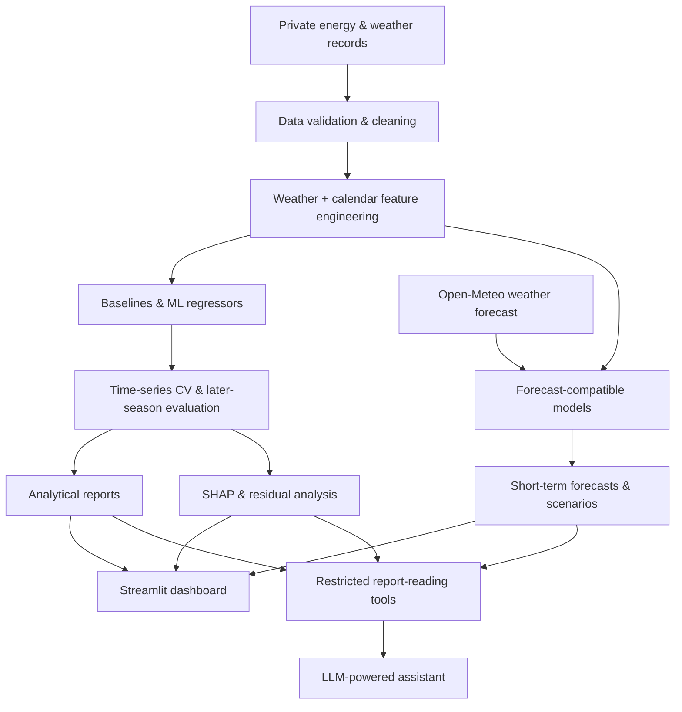

<div align="center">

# 🏢⚡ Intelligent Building Energy Analytics

### Machine Learning · Weather-Aware Forecasting · Explainable AI · LLM Agent

**From multidimensional energy signatures to an AI-assisted building energy analytics workflow.**


[**Overview**](#-project-overview) · [**Workflow**](#-system-workflow) · [**AI Components**](#-from-prediction-to-ai-assisted-analytics) · [**Methodology**](Methodology.md) · [**Confidentiality**](#-confidentiality--repository-scope)

</div>

---

## 🌍 Project Overview

**Can we understand and forecast a building's energy demand using more than outdoor temperature?**

Traditional *energy signature* models largely describe the relationship between heating demand and ambient temperature. This project takes a broader approach: combining **weather conditions, engineered thermal indicators, calendar patterns, and machine learning** to analyze daily natural-gas consumption.

The work started as a **Master's research project in Data Science and Engineering**, conducted in collaboration with an industrial partner, and was subsequently extended into a private, modular analytics prototype featuring **short-term forecasting, explainability, anomaly flagging, a Streamlit dashboard, and a tool-using LLM assistant**.

> 🔐 **Public repository:** This repository presents the **research methodology and system design**. Customer data, building identifiers, trained models, experimental results, internal plots, and the private application source code are **not published**.

## ✨ What the Project Covers

| Component | What it does |
| :--- | :--- |
| 🧹 **Data preparation** | Cleans daily energy and weather records, validates dates, and builds chronological features. |
| 📈 **Machine learning** | Compares interpretable baselines with linear and tree-based regressors for daily gas-consumption prediction. |
| 🕒 **Time-aware validation** | Uses expanding-window cross-validation and a separate later heating season to assess generalization. |
| 🌦️ **Weather-aware forecasting** | Uses forecast-compatible variables and Open-Meteo inputs for short-horizon consumption estimates. |
| 🌡️ **Scenario analysis** | Recalculates predictions under warmer or colder temperature assumptions. |
| 🧠 **Explainable AI** | Uses SHAP to investigate which features contribute to model predictions. |
| 🚨 **Anomaly flagging** | Highlights unusually large differences between observed and predicted consumption. |
| 📊 **Streamlit dashboard** | Brings together predictions, diagnostics, scenarios, and feature importance. |
| 💬 **LLM-powered assistant** | Uses predefined report-reading tools to answer natural-language questions about the analyses. |

## 🧩 System Workflow



*Conceptual architecture of the private implementation; not a public runnable pipeline.*

## 🔬 Research Foundation: Multidimensional Energy Signatures

### 🌡️ Input features

The supervised-learning target is **daily natural-gas consumption**, expressed in standard cubic metres (Smc/day). Explanatory variables explored in the private study include:

| Group | Examples |
| :--- | :--- |
| **Temperature** | Daily mean, minimum and maximum temperature |
| **Weather** | Humidity, dew point, wind speed/gusts, atmospheric pressure, precipitation |
| **Thermal indicators** | Heating Degree Days (HDD), Cooling Degree Days (CDD), rolling temperature averages |
| **Calendar** | Weekday, weekend and month |
| **Interactions** | Selected combinations of temperature and other weather variables |

The degree-day features use an **18 °C reference temperature**:

$$
\mathrm{HDD}=\max(0,18-T_{\mathrm{mean}}),\qquad
\mathrm{CDD}=\max(0,T_{\mathrm{mean}}-18)
$$

Not all inputs are used in every model. For live forecasting, the system uses a **separately defined, forecast-compatible feature subset** rather than assuming all historical weather measurements are available in advance.

### 🤖 Models evaluated

| Baseline models | Linear regression | Ensemble learning |
| :--- | :--- | :--- |
| Mean consumption | Linear Regression | Random Forest |
| Temperature-only signature | Ridge Regression | XGBoost |
| — | Lasso Regression | CatBoost |

Model/feature combinations are selected using **time-series cross-validation**, then evaluated on an **unseen subsequent heating season**. The analysis tracks MAE, RMSE, R² and prediction bias, while keeping simple baselines for comparison.

> 💡 **An important research lesson:** A model that performs well within one heating season may generalize poorly to another. Weather is not the only source of variation; changes in building operation and energy-use patterns also matter. Model complexity alone does not guarantee better predictions.

## 🚀 From Prediction to AI-Assisted Analytics

### 01 · 🌦️ Weather Forecasting & What-If Scenarios

A dedicated forecasting branch uses weather inputs from [Open-Meteo](https://open-meteo.com/) to generate short-horizon building-level gas-consumption estimates. The same model can be queried with adjusted temperature assumptions to explore *what-if* scenarios.

**Interpretation:** These are model-based estimates and sensitivity comparisons—not measured future demand or causal estimates of energy savings. Historical scores based on observed weather do not validate live forecast accuracy.

### 02 · 🧠 SHAP Explainability

SHAP helps interpret **how the fitted model uses its input features**. Feature-attribution summaries support questions such as whether temperature, recent weather patterns, or calendar indicators contribute strongly to the model's predictions.

**Interpretation:** SHAP describes model behavior; it does not prove causal effects.

### 03 · 🚨 Anomaly Detection

Actual consumption is compared with predictions made without training on the evaluated observations. Large residuals are flagged using an error threshold estimated from earlier time-series validation.

**Interpretation:** An anomaly flag means **unusual prediction error**, not a confirmed equipment fault. Seasonal drift, data issues, or operating changes may also explain the discrepancy.

### 04 · 📊 Interactive Dashboard

The private Streamlit dashboard brings together historical predictions, model metrics, anomaly flags, feature-importance summaries, and short-term weather scenarios in a building-oriented view.

### 05 · 💬 Tool-Calling LLM Agent

An experimental LLM assistant provides a natural-language interface to **predefined analytical reports** through restricted tools. Instead of inventing consumption values, the model is designed to retrieve relevant information and explain it in context.

```text
User question
     |
     v
LLM selects a report-reading tool
     |
     v
Model metrics / forecast / SHAP / anomaly summary
     |
     v
Tool result -> natural-language explanation
```

This is a **single tool-using agent**, not a multi-agent architecture, a RAG system, or an autonomous HVAC controller.

## 🛠️ Technology Stack

| Area | Technologies |
| :--- | :--- |
| **Data science** | Python, pandas, NumPy |
| **Machine learning** | scikit-learn, XGBoost, CatBoost |
| **Explainability & visualization** | SHAP, Matplotlib |
| **Weather input** | Open-Meteo API |
| **Interactive analytics** | Streamlit |
| **LLM integration** | Groq-hosted LLM, function/tool calling |

## 📂 Repository Contents

```text
intelligent-building-energy-analytics/
├── README.md          # Project overview and architecture
└── Methodology.md     # Technical workflow and evaluation protocol
```

The **private** implementation is organized into focused modules: `data.py`, `modeling.py`, `forecasting.py`, `analysis.py`, `app.py`, and `assistant.py`. Those files are described here to explain the architecture; they are **not** included in this public repository.

📖 **Technical details:** [Read Methodology.md](Methodology.md)

## 🔒 Confidentiality & Repository Scope

This work was developed in an industrial research context. Under the project partner's confidentiality restrictions, the public repository does **not** include:

- Original datasets or customer/building identifiers
- Trained models or model parameters
- Experimental results, performance figures, or customer-derived visualizations
- Internal research reports or the full private source code

There is **no public installation or demo** because the underlying project assets cannot be distributed. The purpose of this repository is to document **the implemented methods, engineering decisions, and system architecture** without presenting invented replacement data or fabricated results.

---

<div align="center">

*Master's research and internship in Data Science & Engineering · Building energy modeling · Applied ML & AI analytics*

</div>
